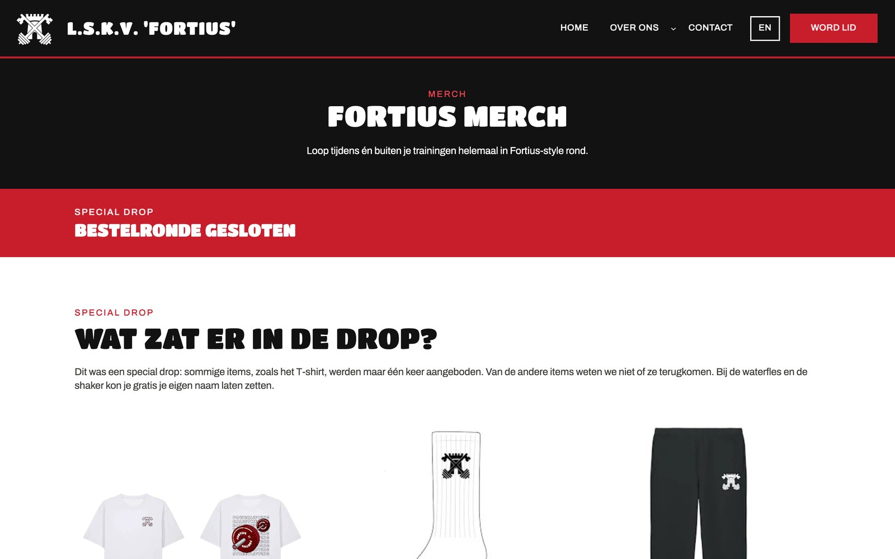
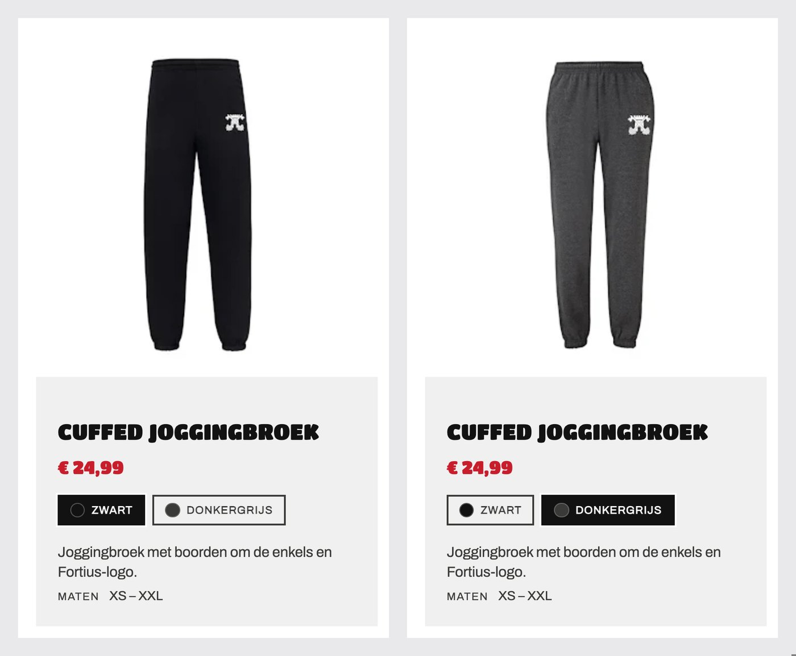
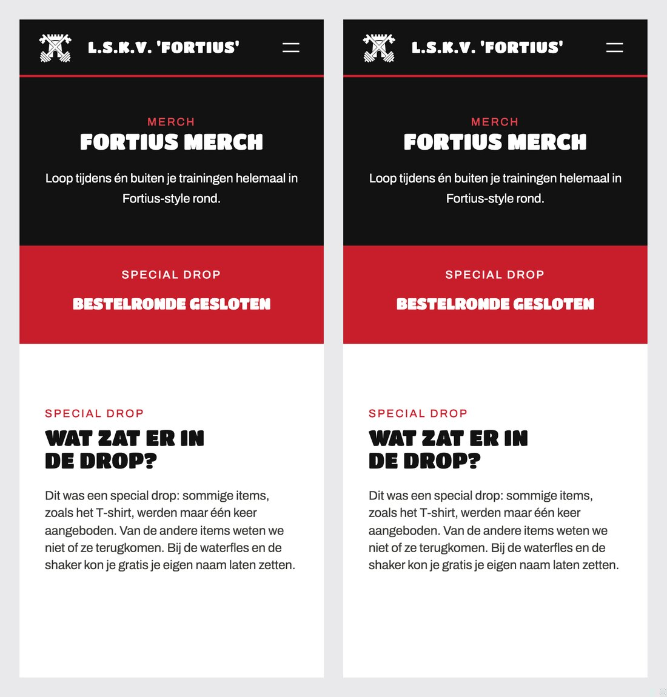
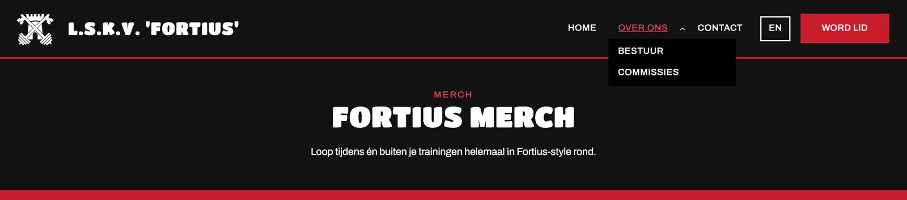
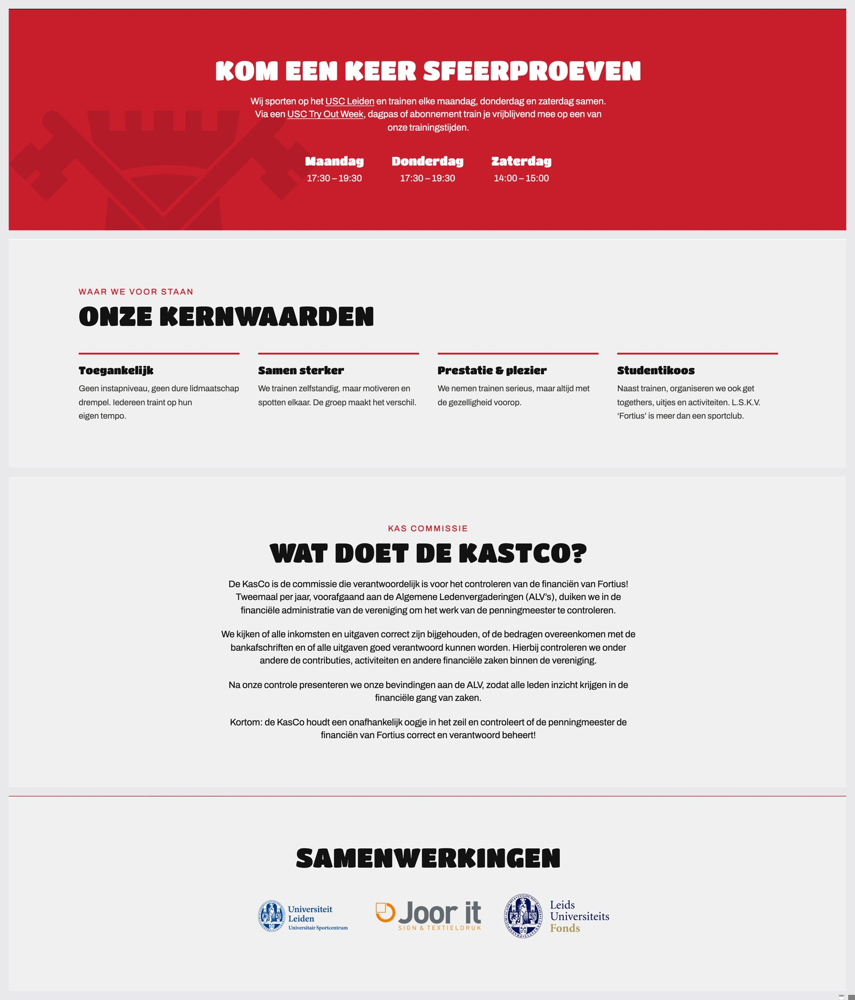

# L.S.K.V. 'Fortius' website

Source, build tooling and documentation for **lskvfortius.nl**, the website of a Leiden student powerlifting association. The site runs on a WordPress.com Personal plan; this repository holds everything I built *around* WordPress so a non-developer board can keep editing it in the WordPress UI.

> Live site: https://lskvfortius.nl  
> This repo does not host the site. It contains the source (CSS, block patterns, page content) and the scripts used to build, audit and deploy it.

## The problem

The board needed a site that anyone could update without code, with a consistent look, while paying for the cheapest WordPress.com plan. That plan has real limits: no custom themes or plugins, and the Global Styles panel silently drops some settings.

## What I built

- **A reusable design system inside WordPress**: a colour palette and typography set in Global Styles, section styles (dark / red / white / grey), buttons, annotation labels, and about 25 block patterns the board can insert from the editor (hero, text + photo, product card, FAQ, contact band and more).
- **Workarounds for the plan limits**: WordPress.com doesn't persist block-style-variation overrides, so `tools/build-dist.py` generates the equivalent plain CSS and appends it to the Additional CSS. About 1,900 lines of hand-written CSS in `src/additional.css`, audited down to about 40 `!important` rules (from several hundred) (`tools/important-audit.mjs`).
- **A merch page** (`tools/make-merch.py` generates it): product cards with colour variants and image switching driven by image captions (so editors rename a colour by editing a caption), a countdown to the order deadline, an embedded Google Form, and a closed state for after the drop. Includes a small, dependency-free script that survives WordPress's content filtering.
- **Pages and navigation**: Bestuur, Commissies (alternating sections, text-only variant when there is no photo), a dropdown menu that works in the mobile overlay, and a highlighted "Merch" nav button with reduced-motion support for the time of a drop.
- **Accessibility and SEO**: alt text on every image (also in the media library defaults), form iframe titles, contrast-checked red-on-black text colour, `prefers-reduced-motion`, meta descriptions from page excerpts, JSON-LD organisation data.
- **English version** under `/en/`: an English twin of every page, with its own header, footer, menu and page template (`src/content/en/`), since the plan has no multilingual plugin.
- **Verification tooling** (`tools/`): computed-style snapshot diffing between the local copy and the live site, screenshot scripts, an a11y check, an image-weight report.
- **Docs for the board** (`docs/`): an editor guide in plain language, a deploy runbook, a CSS audit and a Global Styles checklist.

## How it works

1. Work happens on a local WordPress copy (WordPress Studio).
2. `tools/build-dist.py` turns `src/` into deployable output (`dist/`): merged Global Styles, CSS, page and pattern content with the live domain.
3. Changes go to the live site through the WordPress REST API from the logged-in admin, with checksum checks before each write.
4. Visual regression: `node tools/snapshot.mjs <url> out.json`, then compare against a baseline.

```
src/        hand-written CSS, block patterns, page content, global styles
tools/      build, content migration, merch generator, audit and screenshot scripts
docs/       editor guide, deploy runbook, audits, nav concept screenshots
assets/     placeholder image used in patterns
screenshots/ a few screens of the result
```

## Screenshots



*The merch page after the order round closed: hero, status band, product grid.*

| Colour selector (editors rename a colour via the image caption) | Mobile page and menu with dropdown |
|---|---|
|  |  |



*Section variants from the design system (red band, values grid, text-only block, logo row):*



(Screenshots are generated with `tools/readme-shots.mjs`.)

## Notes

- Copyright (c) 2026 Aidan Verkerk. All rights reserved: the code is public for viewing as a portfolio piece, not for reuse (see `LICENSE`). The association's content, logo and photos belong to the association and are not included. Names of board members are redacted in the page content.
- Python 3 and Node are needed for the tools (`cd tools && npm install`). Some scripts assume the local WordPress Studio paths of my machine.
